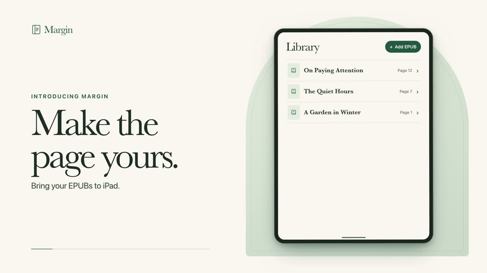
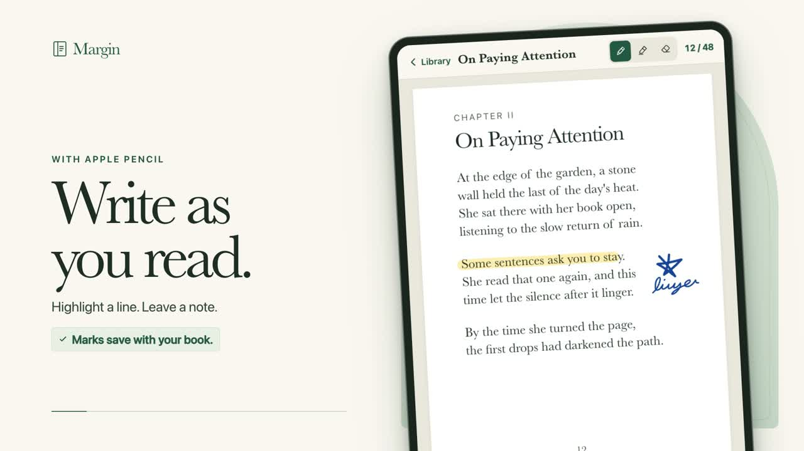

# Margin

An iPad EPUB reader with room to think. Import a DRM-free book, then write directly on its pages and in wide margins with Apple Pencil.

> Early prototype. Source-only release. No books or personal notes are included.

## See Margin in motion

Illustrative animated previews, not recordings of the running app. All books, prose and marks shown are original demo content, not a personal library.

### The 20-second overview

https://github.com/user-attachments/assets/449f58af-3ed7-4229-9d72-a28fc728949c

### The 10-second cut

https://github.com/user-attachments/assets/1347e2a4-6853-4c99-8587-bf101bc7583c

Can't see the players? [Open the 20-second video](https://github.com/user-attachments/assets/449f58af-3ed7-4229-9d72-a28fc728949c) · [Open the 10-second video](https://github.com/user-attachments/assets/1347e2a4-6853-4c99-8587-bf101bc7583c)

*Illustrative stills from the demos. Physical Apple Pencil testing remains outstanding.*

## What works

- Import DRM-free EPUBs from Files. Margin creates a fixed PDF page layout locally for stable annotations.
- Write, highlight and erase with Apple Pencil; use a finger to scroll and pinch to zoom.
- Resume books at the saved page, or jump to a page number.
- Save drawings and reading positions separately for each imported book.
- Reimporting the same EPUB opens the existing library copy.

Margin currently imports EPUB, not arbitrary PDFs. It is not a reflowable reader: changing font size after import is not supported. DRM-protected books are not supported. EPUB rendering varies with book complexity.

## Build

1. Use a Mac with Xcode and an iOS SDK supporting iPadOS 17 or later.
2. Open `Margin.xcodeproj`.
3. For the simulator, select an iPad simulator and Run.
4. For your own iPad, choose your development team and a unique bundle identifier under Signing & Capabilities, then Run. Apple signing requirements apply.

This project uses `com.example.margin.reader` so it does not replace the author's private app. Do not change your existing app's identity or delete it just to try this build. Deleting an app can remove its local books and notes.

No external Swift packages or API keys are required. The app uses SwiftUI, UIKit, PencilKit, WebKit, PDFKit, CryptoKit and system zlib.

## Privacy and books

Import only content you have permission to use. No sample commercial books are bundled. Books are prepared on-device and notes are stored in the app's local container. There is no account, server, telemetry SDK or cloud-sync feature in this source. OS backups and the Files provider you select are separate services. See [PRIVACY.md](PRIVACY.md).

## Status

This is an early personal prototype. The previews use original sample content. Physical Apple Pencil behavior and broad EPUB compatibility still need testing. See [RELEASE-CHECKLIST.md](RELEASE-CHECKLIST.md).

## License

Code and documentation are available under the [MIT License](LICENSE). Imported books remain subject to their own copyrights; this license does not grant rights to book content.
